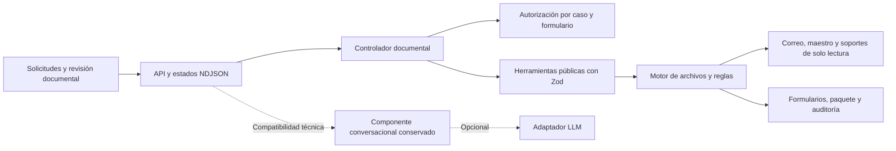

# Solución del agente de registro como proveedor

## 1. Problema y usuaria

La analista administrativa repite la transcripción de datos y la búsqueda de soportes para registrar a la empresa como proveedor; el aplicativo prepara formularios y documentación trazables para revisión y firma humana.

La nueva instrucción del usuario sustituye el chatbot por una pantalla de preparación documental. El [PRD original](docs/PRD_RETO_01.md) exigía explícitamente chat y se conserva sin modificar; el cambio de alcance se registra en [FLUJO_DOCUMENTAL.md](docs/FLUJO_DOCUMENTAL.md). No se afirma que la nueva UI cumpla la exigencia conversacional original. Se conservan los fixtures de solo lectura, contratos Zod, reglas R1–R5 y la preparación sin firma ni envío. Las entradas son correos representados en JSON; no se conecta una bandeja real.

## 2. Arquitectura y fuentes de verdad

Es un monolito modular por capas. `src/contracts/workflow.ts` define operaciones, estados y eventos estrictos; `src/workflow/registration.ts` decide la secuencia de preparación. `src/tools/proveedor.ts` expone los cinco objetos del PRD con `description`, argumentos Zod y JSON serializado controlado. El contexto confiable aporta el UUID de sesión y motor; el navegador solo elige un caso y autoriza una pregunta vigente, nunca aporta valores del maestro.

`src/tools/engine.ts` conserva mapeo, reglas tributarias, evaluación de soportes, generación y descargas aisladas. El servidor gestiona HTTP y sesiones, sin reglas de negocio. La interfaz muestra resultados explícitos de las herramientas, con fuentes. No se usa IA para completar o inventar información. `agent/prompt.md`, conocimiento y adaptador LLM quedan separados y disponibles para el componente conversacional conservado, sin ser dependencias del flujo documental.

## 3. Proceso automático y cierre humano

Seleccionar una solicitud lee correo, adjuntos, país, formato y soportes exigidos. Un clic en **Preparar documentos** ejecuta lectura, mapeo y formulario; devuelve progreso, campos con fuente, datos faltantes y soportes evaluados. El usuario revisa y responde la pregunta **Sí, preparar paquete**. La autorización está ligada mediante UUID a la sesión, caso y formulario y se consume una vez. Cancelar, cambiar de solicitud o regenerar descarta el permiso anterior. Un booleano sin pregunta vigente no habilita la herramienta.

El paquete contiene el formulario, soportes existentes, checklist, manifiesto y borrador de correo. Su estado depende de presencia/vigencia de soportes. Un paquete con pendientes es descargable como borrador pero no se marca listo para firma. La entrega siempre mantiene firma pendiente y revisión humana, incluidas equivalencias fiscales. El flujo no llama a `proveedor_simular_envio` ni propone envío; termina en la descarga para firma. Portal genera solo valores copiables y termina en gestión manual.

Cada sesión admite una preparación a la vez. Los errores se muestran sin romper el resto del proceso; una plantilla corrupta conserva el correo ya leído y permite seleccionar otro caso. Ante pérdida de conexión, la UI consulta `GET /api/workflow` antes de ofrecer un reintento humano y no repite automáticamente acciones críticas. Estados y descargas son privados de la sesión. La auditoría conserva timestamp, herramienta, éxito/error y `sessionId`, sin valores sensibles.

## 4. Modelo opcional conservado, costo y control de gasto

La pantalla documental no llama al modelo y su preparación no consume tokens. Para la API conversacional conservada se eligió OpenAI `gpt-4.1-mini` por el soporte de salida JSON estructurada y porque la tarea requiere clasificación y selección de datos, no redacción extensa. `LlmAdapter.enviar(mensajes, herramientas, opciones)` aísla el proveedor. Otro adaptador se inyecta al crear la sesión sin modificar el ciclo; su nombre debe coincidir con `LLM_PROVIDER`. La implementación incluida es OpenAI; no se afirma haber integrado otros proveedores.

Los esquemas de argumentos se convierten desde Zod con `zod-to-json-schema`; el modelo recibe descripciones y contratos. `tool_choice:none` mantiene el despacho bajo control de la aplicación. Solo puede elegir una intención o referencias a evidencia; el código nunca publica prosa libre ni argumentos ejecutables sugeridos por el modelo.

Una consulta suele requerir dos llamadas: clasificación y selección. El flujo documental completo no llama al LLM; los comandos exactos del componente anterior tampoco. El costo real depende del texto, las herramientas y las tarifas vigentes. Fórmula: `(tokens_entrada × precio_entrada + tokens_salida × precio_salida) / 1.000.000`. Como ejemplo de estimación, no cotización vigente, 20.000 tokens de entrada y 1.500 de salida con tarifas supuestas de USD 0,40 / USD 1,60 por millón darían **USD 0,0104 por caso**. Verificar precios actuales en https://openai.com/api/pricing/ antes de publicar. No se midió consumo real sin una clave disponible.

El runtime reserva un presupuesto conservador basado en bytes UTF-8 de la carga completa, margen de protocolo y salida máxima. `LLM_MAX_SESSION_TOKENS` limita la sesión y `LLM_MAX_DAILY_TOKENS` limita el proceso por día UTC; crear otra sesión no elimina el segundo límite. Se cuentan reservas de llamadas fallidas y no se reembolsan según `usage`. Esto puede bloquear antes del consumo real. Los límites se reinician al reiniciar el proceso y no se comparten entre réplicas; en producción se requiere un contador central y un límite de gasto en la cuenta del proveedor. También se limita el ritmo de POST por IP con `CHAT_RATE_LIMIT`.

## 5. Portales web — diseño de §7.4

El caso PA produce `valores-portal.md` y declara «formato no soportado». No inicia sesión ni afirma haber cargado datos. El operador copia los valores y revisa equivalencias y soportes.

Una integración futura usaría Playwright/RPA con selectores de etiquetas y roles, pruebas por versión del portal, captura de errores y pausa ante layout desconocido. La automatización solo prepararía campos y adjuntos en una sesión controlada; antes de cambios críticos se mostraría una vista previa. CAPTCHA, MFA, cambios de estructura y restricciones del cliente obligan a detenerse y ceder el control al humano, sin intentos de elusión.

Las credenciales las ingresa el operador directamente en el navegador del portal, o las obtiene de un gestor corporativo autorizado fuera del prompt y de los fixtures. No pasan al LLM, al repositorio ni a logs. En un navegador remoto, se deshabilitarían grabaciones de las pantallas de autenticación, se aislarían perfiles por operador y se destruirían cookies al terminar. El ingreso de credenciales, la resolución de MFA/CAPTCHA y el clic final «Enviar» serían humanos. La autorización de preparación no sustituye esa decisión.

## 6. Decisiones y trade-offs

| Decisión | Alternativa descartada y motivo |
|---|---|
| Respuestas construidas con referencias a evidencia | Prosa libre del LLM: permitiría introducir nombres, cuentas o estados sin fuente verificable. La selección puede ser poco pertinente, pero los valores presentados provienen de herramientas. |
| Fachada pública y motor interno con UUID | Confiar en rutas y `confirmado` enviados por el modelo: permitiría descargar o usar artefactos ajenos y saltar confirmaciones. |
| HTML/JavaScript sin framework | SPA con build adicional: no aporta una necesidad del reto y añade dependencias. El backend y las herramientas siguen en TypeScript. |
| Documentos reconstruidos desde mapas JSON | Rellenar binarios originales: no fueron entregados. Excel conserva hojas y celdas del mapa; PDF conserva orden, etiqueta y valor, modalidad aceptada por el PRD. |
| Exportación canónica y copias privadas de descarga | Sobrescribir el archivo de una sesión al preparar otra: los UUID privados mantienen las descargas aisladas. Las rutas `out/<caso>/` muestran la última exportación y pueden cambiar entre sesiones. |
| Presupuesto reservado por bytes | Presupuestar solo cuando vuelve `usage`: no impediría peticiones fallidas o repetidas y permitiría superar el presupuesto antes de bloquear. |
| Memoria y archivos locales | Base de datos y correo real: fuera de alcance del reto. No hay firma ni envío real. |

## 7. Supuestos y reglas implementadas

- Las equivalencias del glosario son exactas; no se introducen sinónimos inventados. Un campo sin equivalencia o valor es `faltante`.
- NIT colombiano usado en EC/PE/PA/HN se marca `requiere_confirmacion`, confianza 0,7, nota «identificador extranjero» y equivalente RUC/RTN. Etiquetas fiscales ambiguas requieren revisión; coincidencias explícitas ordinarias tienen confianza 1.
- Se conservan cuentas e identificaciones como texto. Los datos bancarios solo se escriben en campos pedidos por la plantilla y nunca se agregan al correo borrador.
- Un soporte ausente, archivo faltante o vencido bloquea `listo_para_firma`. Un campo faltante no lo bloquea por sí solo, pero todos los faltantes, incluso opcionales, se muestran en el checklist. Requiere revisión humana, no aceptación legal automática.
- El vencimiento se evalúa contra la fecha UTC de ejecución. El demo predeterminado usa hoy y limpia `out/` al iniciar. `--historico` permite evaluar cada solicitud a su fecha original y lo declara en la salida. No ejecutar el demo junto con un servidor cuyos documentos se quieran conservar.
- `repositorio/` es admitido cuando existe. Los fixtures recibidos conservan su estructura y contenido originales para evitar alterar evidencia.
- Los placeholders no prueban autenticidad, emisión reciente ni aceptación legal de soportes.

## 8. Cobertura por historia y entrega

| Historia / componente | Estado | Evidencia y límite de producción |
|---|---|---|
| HU-1: leer solicitud y plantilla | Hecho | País, cliente, formato, campos, revisiones y soportes; plantilla corrupta permite seguir leyendo el correo con advertencia. |
| HU-2: mapear y reportar faltantes | Hecho | Fuente del maestro, tres estados, confianza y revisión tributaria; falta validación legal de equivalencias reales. |
| HU-3: Excel/PDF | Hecho | Hojas/celdas del mapa y PDF ordenado; no hay binarios originales que preservar. |
| HU-3: portal | Hecho para alcance P2 | Archivo copiable y declaración de formato no soportado; acceso real excluido. |
| HU-4: paquete para revisión y firma | Hecho | Formulario, soportes disponibles, checklist, borrador de correo y ZIP. Sin simulación en la pantalla. La quinta herramienta original sigue en el demo técnico. |
| Front conversacional del PRD original | Sustituido por instrucción posterior | Pantalla documental sin entrada de mensajes; cambio de alcance registrado explícitamente. |
| HU-5: recuperación de errores | Hecho | Contratos controlados, timeout, fallos de plantilla, proveedor y auditoría; la sesión sigue disponible y puede preparar otra solicitud. |
| API, logs, conocimiento, presupuestos | Hecho | Historial con usuario/herramientas, health sin clave, logs global y por caso, límites configurables. |
| Bonus: módulo reutilizable | Hecho | `modulo/`, herramientas reexportadas y prompt/conocimiento generados; `module:check` evita divergencia. No importa servidor HTTP. |
| URL pública | Pendiente de activación | Docker/Render preparados, requiere cuenta de hosting; la pantalla no necesita clave LLM. Conexión real del componente opcional sigue sin acreditar. |

## 9. Uso de IA

Se usó Codex para inspección de adjuntos, definición de contratos, implementación, pruebas, revisión del PRD y documentación. En la actualización documental se separó el controlador del agente conversacional, se reemplazó la UI y se adaptaron E2E a las tareas administrativas. Se descartó añadir una integración real de correo porque es un no-objetivo del PRD y no había cuenta autorizada. La herramienta de imágenes se usó para preparar el fondo a partir de la referencia visual; es una versión reprocesada, descrita en `docs/DISENO.md`.

Se descartó permitir que el LLM devuelva valores o prosa libre del proveedor: se implementó selección de evidencia. También se corrigieron decisiones iniciales al recibir el PRD completo: bloqueo por campos faltantes, ausencia de archivos de cierre, estados del mapeo e interfaz de herramientas. El historial Git permite revisar esos cambios. No se afirma revisión humana línea por línea: la guía `EXPLICACION_CODIGO.md` ayuda a preparar esa defensa y las pruebas ejercitan los comportamientos críticos.

El LLM del aplicativo, cuando se configure, clasifica intención y selecciona evidencia. No firma, ejecuta shell, actualiza fixtures ni autoriza acciones.

## 10. Riesgos y mitigaciones de producción

- Publicación con clave propia: limitar gasto también en OpenAI; autenticación, cuotas por usuario y contadores compartidos antes de múltiples réplicas.
- Persistencia: memoria pierde sesiones al reiniciar; usar almacenamiento cifrado, retención, backups y logs centralizados. Las exportaciones canónicas son compartidas; las descargas de sesión usan copias privadas.
- Datos sensibles: minimización antes de enviarlos al proveedor, acuerdos de tratamiento, permisos por empresa, cifrado y políticas de retención. Hoy los datos son ficticios.
- Archivos y plantillas reales: análisis de formatos, límites de tamaño, revisión del contenido y pruebas con documentos representativos.
- Firma y validez legal: mantener revisión humana y verificar equivalencias y vigencias con el dueño del dato.
- Despliegue gratis: puede dormir o borrar archivos. Mantener el servicio activo para la defensa y descargar el paquete. No se comprobó el arranque en menos de dos minutos en una máquina limpia.

La evidencia ejecutada está en `docs/VALIDACION.md`, la configuración en `README_LLM.md`, el despliegue en `docs/DESPLIEGUE.md` y la explicación completa del código y su evolución en `EXPLICACION_CODIGO.md`.

## Dependencias justificadas

| Dependencia | Necesidad |
|---|---|
| Zod | Validar entradas, salidas, fixtures e interfaces de herramientas. |
| zod-to-json-schema | Derivar contratos del modelo desde los mismos esquemas Zod, sin mantener otra definición manual. |
| ExcelJS | Crear y verificar libros XLSX con hojas/celdas del mapa. |
| pdf-lib | PDF generado con etiquetas y valores ordenados; no depende de una plantilla binaria ausente. |
| fflate | Crear y comprobar el ZIP de formulario, soportes y documentación. |
| dotenv | Leer configuración local de backend desde `.env`. |
| TypeScript, tipos Node y tsx | Tipado estricto, compilación y ejecución local de fuentes/scripts. |
| Playwright | E2E de navegador y descargas contra backend real. |
| Bun local | Verificar el comando de demo exigido, sin obligar al usuario a instalarlo globalmente. |

`pnpm-workspace.yaml` fija `exceljs>uuid` en 11.1.1 para sustituir una versión transitiva vulnerable manteniendo el uso CommonJS de ExcelJS. El lockfile conserva integridad y versiones. La auditoría actual de producción no encontró vulnerabilidades conocidas.
