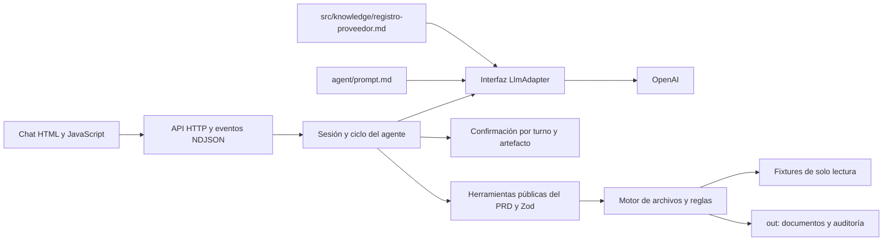

# Solución del agente de registro como proveedor

## 1. Problema y usuaria

La analista administrativa repite la transcripción de datos y la búsqueda de soportes para registrar a la empresa como proveedor; el aplicativo prepara formularios y documentación trazables para revisión y firma humana.

La implementación se alinea con el [PRD v2.0 del 3 de septiembre de 2026](docs/PRD_RETO_01.md), recibido completo después de los primeros desarrollos, y con R1–R5 del usuario. Conserva los 21 fixtures originales sin editar sus contenidos. El maestro y los soportes llegaron en la raíz de `fixtures/reto-01`; el lector admite tanto esa distribución como la distribución `repositorio/` del PRD. Perú está soportado como regla tributaria, pero no se inventó un caso peruano ausente de los adjuntos.

## 2. Arquitectura y fuentes de verdad

El comportamiento del modelo vive en `agent/prompt.md`; el conocimiento del proceso en `src/knowledge/registro-proveedor.md`; la ejecución en `src/tools/`. El servidor no contiene el prompt ni las reglas de mapeo, vigencia o firma. El contrato ejecutable es `src/contracts/proveedor.ts`: entradas y salidas se validan con Zod. `src/tools/proveedor.ts` exporta los cinco objetos obligatorios con `description`, `args` descritos y `execute(args, ctx)` que retorna JSON serializado y captura fallos. El contexto confiable contiene raíz del proyecto y UUID de sesión; no procede del modelo.

La fachada pública usa `{caso}`, `{caso,campos}`, `{caso,mapeo}`, `{caso}` y `{caso,confirmado}`. El motor conserva contratos internos con `caso_id` y UUID de artefacto para seguridad y compatibilidad con las pruebas existentes. La aplicación y el demo invocan la fachada pública. Los campos y el mapeo aportados se contrastan con los fixtures: pasar un valor inventado no modifica el maestro ni el formulario.

## 3. Ciclo, límites y confirmación humana

Por turno, el agente valida el caso y la sesión, cancela o consume la confirmación inmediata, clasifica la intención, ejecuta la secuencia permitida de herramientas y construye la respuesta. Para preguntas, vuelve a leer y mapear el caso, envía evidencia al LLM y valida las referencias seleccionadas. Es un ciclo con rutas acotadas, no un bucle abierto que permita al modelo ejecutar herramientas arbitrarias.

`AGENT_MAX_ITERATIONS` limita pasos visibles de herramientas y llamadas al modelo (predeterminado 25, máximo 25). Al alcanzar el límite conserva los resultados en el historial y termina con un mensaje claro. Los fallos del proveedor tienen timeout configurable y no cierran la sesión.

`ConfirmationGate` exige una pregunta explícita y la afirmación completa en el turno inmediatamente posterior. El permiso especifica caso, acción y artefacto y se consume una vez. `confirmado:true` por sí solo no autoriza la simulación. Empaquetar también exige confirmación por la instrucción R4 original del usuario. Después del paquete se muestra un resumen y una nueva pregunta para la simulación. Una consulta, rechazo o cambio de caso cancela el permiso pendiente. Esta doble confirmación conserva la instrucción original incluso cuando el ejemplo del PRD parezca condensar la preparación en un turno.

El prompt de defensa que nombra un caso cambia la selección solo después de verificarlo mediante una herramienta. Primero se reportan campos y evaluación previa de soportes; el paquete se crea tras confirmar. Evaluación previa no significa paquete existente, documento firmado ni aceptación del cliente.

## 4. Modelo, costo y control de gasto

Se eligió OpenAI `gpt-4.1-mini` por el soporte de salida JSON estructurada y porque la tarea requiere clasificación y selección de datos, no redacción extensa. `LlmAdapter.enviar(mensajes, herramientas, opciones)` aísla el proveedor. Otro adaptador se inyecta al crear la sesión sin modificar el ciclo; su nombre debe coincidir con `LLM_PROVIDER`. La implementación incluida es OpenAI; no se afirma haber integrado otros proveedores.

Los esquemas de argumentos se convierten desde Zod con `zod-to-json-schema`; el modelo recibe descripciones y contratos. `tool_choice:none` mantiene el despacho bajo control de la aplicación. Solo puede elegir una intención o referencias a evidencia; el código nunca publica prosa libre ni argumentos ejecutables sugeridos por el modelo.

Una consulta suele requerir dos llamadas: clasificación y selección. Los botones y comandos exactos no llaman al LLM. El costo real depende del texto, las herramientas y las tarifas vigentes. Fórmula: `(tokens_entrada × precio_entrada + tokens_salida × precio_salida) / 1.000.000`. Como ejemplo de estimación, no cotización vigente, 20.000 tokens de entrada y 1.500 de salida con tarifas supuestas de USD 0,40 / USD 1,60 por millón darían **USD 0,0104 por caso**. Verificar precios actuales en https://openai.com/api/pricing/ antes de publicar. No se midió consumo real sin una clave disponible.

El runtime reserva un presupuesto conservador basado en bytes UTF-8 de la carga completa, margen de protocolo y salida máxima. `LLM_MAX_SESSION_TOKENS` limita la sesión y `LLM_MAX_DAILY_TOKENS` limita el proceso por día UTC; crear otra sesión no elimina el segundo límite. Se cuentan reservas de llamadas fallidas y no se reembolsan según `usage`. Esto puede bloquear antes del consumo real. Los límites se reinician al reiniciar el proceso y no se comparten entre réplicas; en producción se requiere un contador central y un límite de gasto en la cuenta del proveedor. También se limita el ritmo de POST por IP con `CHAT_RATE_LIMIT`.

## 5. Portales web — diseño de §7.4

El caso PA produce `valores-portal.md` y declara «formato no soportado». No inicia sesión ni afirma haber cargado datos. El operador copia los valores y revisa equivalencias y soportes.

Una integración futura usaría Playwright/RPA con selectores de etiquetas y roles, pruebas por versión del portal, captura de errores y pausa ante layout desconocido. La automatización solo prepararía campos y adjuntos en una sesión controlada; antes de cambios críticos se mostraría una vista previa. CAPTCHA, MFA, cambios de estructura y restricciones del cliente obligan a detenerse y ceder el control al humano, sin intentos de elusión.

Las credenciales las ingresa el operador directamente en el navegador del portal, o las obtiene de un gestor corporativo autorizado fuera del prompt y de los fixtures. No pasan al LLM, al repositorio ni a logs. En un navegador remoto, se deshabilitarían grabaciones de las pantallas de autenticación, se aislarían perfiles por operador y se destruirían cookies al terminar. El ingreso de credenciales, la resolución de MFA/CAPTCHA y el clic final «Enviar» serían humanos. La autorización de preparación no sustituye esa decisión.

## 6. Decisiones y trade-offs

| Decisión | Alternativa descartada y motivo |
|---|---|
| Respuestas construidas con referencias a evidencia | Prosa libre del LLM: permitiría introducir nombres, cuentas o estados sin fuente verificable. La selección puede ser poco pertinente, pero los valores presentados provienen de herramientas. |
| Fachada pública y motor interno con UUID | Confiar en rutas y `confirmado` enviados por el modelo: permitiría descargar o usar artefactos ajenos y saltar confirmaciones. |
| HTML/JavaScript sin framework | SPA con build adicional: no aporta una necesidad del reto y añade dependencias. El backend y las herramientas siguen en TypeScript. |
| Documentos reconstruidos desde mapas JSON | Rellenar binarios originales: no fueron entregados. Excel conserva hojas y celdas del mapa; PDF conserva orden, etiqueta y valor, modalidad aceptada por el PRD. |
| Exportación canónica y copias privadas de descarga | Sobrescribir el archivo de una sesión al preparar otra: los UUID privados mantienen las descargas aisladas. Las rutas `out/<caso>/` muestran la última exportación y pueden cambiar entre sesiones. |
| Presupuesto reservado por bytes | Presupuestar solo cuando vuelve `usage`: no impediría peticiones fallidas o repetidas y permitiría superar el presupuesto antes de bloquear. |
| Memoria y archivos locales | Base de datos y correo real: fuera de alcance del reto. No hay firma ni envío real. |

## 7. Supuestos y reglas implementadas

- Las equivalencias del glosario son exactas; no se introducen sinónimos inventados. Un campo sin equivalencia o valor es `faltante`.
- NIT colombiano usado en EC/PE/PA/HN se marca `requiere_confirmacion`, confianza 0,7, nota «identificador extranjero» y equivalente RUC/RTN. Etiquetas fiscales ambiguas requieren revisión; coincidencias explícitas ordinarias tienen confianza 1.
- Se conservan cuentas e identificaciones como texto. Los datos bancarios solo se escriben en campos pedidos por la plantilla y nunca se agregan al correo borrador.
- Un soporte ausente, archivo faltante o vencido bloquea `listo_para_firma`. Un campo faltante no lo bloquea por sí solo, pero todos los faltantes, incluso opcionales, se muestran en el checklist. Requiere revisión humana, no aceptación legal automática.
- El vencimiento se evalúa contra la fecha UTC de ejecución. El demo predeterminado usa hoy y limpia `out/` al iniciar. `--historico` permite evaluar cada solicitud a su fecha original y lo declara en la salida. No ejecutar el demo junto con un servidor cuyos documentos se quieran conservar.
- `repositorio/` es admitido cuando existe. Los fixtures recibidos conservan su estructura y contenido originales para evitar alterar evidencia.
- Los placeholders no prueban autenticidad, emisión reciente ni aceptación legal de soportes.

## 8. Cobertura por historia y entrega

| Historia / componente | Estado | Evidencia y límite de producción |
|---|---|---|
| HU-1: leer solicitud y plantilla | Hecho | País, cliente, formato, campos, revisiones y soportes; plantilla corrupta permite seguir leyendo el correo con advertencia. |
| HU-2: mapear y reportar faltantes | Hecho | Fuente del maestro, tres estados, confianza y revisión tributaria; falta validación legal de equivalencias reales. |
| HU-3: Excel/PDF | Hecho | Hojas/celdas del mapa y PDF ordenado; no hay binarios originales que preservar. |
| HU-3: portal | Hecho para alcance P2 | Archivo copiable y declaración de formato no soportado; acceso real excluido. |
| HU-4: paquete y simulación | Hecho | Formulario, soportes existentes, checklist, correo, ZIP y archivo de simulación confirmado. Firma y correo reales excluidos. |
| HU-5: recuperación de errores | Hecho | Contratos controlados, timeout, fallos de plantilla, proveedor y auditoría; la sesión sigue disponible. |
| API, logs, conocimiento, presupuestos | Hecho | Historial con usuario/herramientas, health sin clave, logs global y por caso, límites configurables. |
| Bonus: módulo reutilizable | Hecho | `modulo/`, herramientas reexportadas y prompt/conocimiento generados; `module:check` evita divergencia. No importa servidor HTTP. |
| URL pública y conexión autenticada | Pendiente de activación | Docker y Render preparados. Requiere cuenta de despliegue y clave propia; no se entrega una URL inventada ni se afirma una conexión real sin probarla. |

## 9. Uso de IA

Se usó Codex para inspección de adjuntos, definición de contratos, implementación, pruebas, revisión del PRD y documentación. La herramienta de imágenes se usó para preparar el fondo a partir de la referencia visual; es una versión reprocesada, descrita en `docs/DISENO.md`.

Se descartó permitir que el LLM devuelva valores o prosa libre del proveedor: se implementó selección de evidencia. También se corrigieron decisiones iniciales al recibir el PRD completo: bloqueo por campos faltantes, ausencia de archivos de cierre, estados del mapeo e interfaz de herramientas. El historial Git permite revisar esos cambios. No se afirma revisión humana línea por línea: la guía `EXPLICACION_CODIGO.md` ayuda a preparar esa defensa y las pruebas ejercitan los comportamientos críticos.

El LLM del aplicativo, cuando se configure, clasifica intención y selecciona evidencia. No firma, ejecuta shell, actualiza fixtures ni autoriza acciones.

## 10. Riesgos y mitigaciones de producción

- Publicación con clave propia: limitar gasto también en OpenAI; autenticación, cuotas por usuario y contadores compartidos antes de múltiples réplicas.
- Persistencia: memoria pierde sesiones al reiniciar; usar almacenamiento cifrado, retención, backups y logs centralizados. Las exportaciones canónicas son compartidas; las descargas de sesión usan copias privadas.
- Datos sensibles: minimización antes de enviarlos al proveedor, acuerdos de tratamiento, permisos por empresa, cifrado y políticas de retención. Hoy los datos son ficticios.
- Archivos y plantillas reales: análisis de formatos, límites de tamaño, revisión del contenido y pruebas con documentos representativos.
- Firma y validez legal: mantener revisión humana y verificar equivalencias y vigencias con el dueño del dato.
- Despliegue gratis: puede dormir o borrar archivos. Mantener el servicio activo para la defensa y descargar el paquete. No se comprobó el arranque en menos de dos minutos en una máquina limpia.

La evidencia ejecutada está en `docs/VALIDACION.md`, la configuración en `README_LLM.md`, el despliegue en `docs/DESPLIEGUE.md` y la explicación completa del código y su evolución en `EXPLICACION_CODIGO.md`.

## Dependencias justificadas

| Dependencia | Necesidad |
|---|---|
| Zod | Validar entradas, salidas, fixtures e interfaces de herramientas. |
| zod-to-json-schema | Derivar contratos del modelo desde los mismos esquemas Zod, sin mantener otra definición manual. |
| ExcelJS | Crear y verificar libros XLSX con hojas/celdas del mapa. |
| pdf-lib | PDF generado con etiquetas y valores ordenados; no depende de una plantilla binaria ausente. |
| fflate | Crear y comprobar el ZIP de formulario, soportes y documentación. |
| dotenv | Leer configuración local de backend desde `.env`. |
| TypeScript, tipos Node y tsx | Tipado estricto, compilación y ejecución local de fuentes/scripts. |
| Playwright | E2E de navegador y descargas contra backend real. |
| Bun local | Verificar el comando de demo exigido, sin obligar al usuario a instalarlo globalmente. |

`pnpm-workspace.yaml` fija `exceljs>uuid` en 11.1.1 para sustituir una versión transitiva vulnerable manteniendo el uso CommonJS de ExcelJS. El lockfile conserva integridad y versiones. La auditoría actual de producción no encontró vulnerabilidades conocidas.
