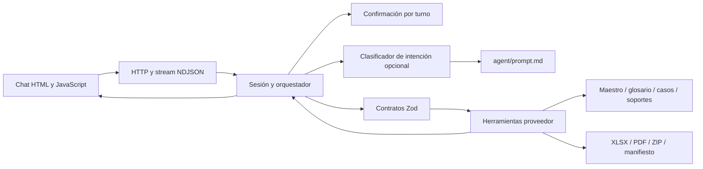

# Solución del agente de registro como proveedor

## Resultado y alcance de la evidencia

El repositorio se creó desde cero sobre los requisitos R1–R5 y 21 adjuntos. Incluye TypeScript sobre Node 22.13+ y pnpm 11.19.0, contratos Zod, las cinco herramientas requeridas, un chat con eventos incrementales, prompt independiente, un demo sin LLM y pruebas de integración.

No se adjuntó el PRD completo ni los XLSX/PDF originales. Por ello, se explicitan las decisiones en `docs/ESPECIFICACION.md`; no se atribuyen reglas a una sección no disponible. La agrupación de archivos con nombres repetidos está registrada en `fixtures/reto-01/origen.json` y se infirió del país, formato, etiquetas y soportes. Ningún dato original fue completado o alterado.

## Arquitectura y SDD

La secuencia SDD fue: inspección de adjuntos, arquitectura comunicada antes de codificar, definición de esquemas, implementación y verificación contra los contratos. `src/contracts/proveedor.ts` define tanto las entradas como las salidas; ninguna herramienta acepta valores libres del modelo ni rutas de archivos. Identificadores fiscales, cuentas y códigos se mantienen como strings. Las funciones de herramienta se despachan usando tipos derivados de Zod.

El servidor en `src/server/index.ts` solo maneja HTTP, validación de transporte, sesiones, archivos autorizados y protección de origen. El flujo, la confirmación, el mapeo y las vigencias viven en módulos separados. El único system prompt es `agent/prompt.md`, leído desde disco por el adaptador LLM; no hay prompt duplicado en el servidor.

## R1: datos verificables y prevención de alucinaciones

El modelo solo puede retornar una intención enumerada. La respuesta del modelo se valida con un esquema estricto; propiedades como `confirmed`, cuentas inventadas, prosa o JSON inválido provocan fallback. No se permite al LLM crear argumentos de herramientas ni autorizar acciones. Esta restricción sacrifica respuestas conversacionales libres, pero hace verificable la ausencia de afirmaciones inventadas en los datos del proveedor.

Los mensajes con datos se serializan desde resultados de herramientas. Cada campo mapeado incluye etiqueta, ruta de maestro, valor, estado y fuente. El chat no ofrece una vía para sobrescribir el maestro con mensajes del usuario. Las plantillas, solicitudes y documentos se tratan como datos, no como instrucciones. El frontend usa `textContent` y no inserta HTML procedente de herramientas o del usuario.

El glosario contiene RUC y RTN como equivalentes de `nit`. Se aplica esa equivalencia tal como fue suministrada, con advertencia explícita sobre la revisión fiscal extranjera. El país del proveedor sigue siendo CO. No se inventan referencias comerciales ni número de contribuyente especial.

## R3: herramientas defensivas

Las entradas y las salidas de las cinco herramientas se verifican con Zod. Errores internos se capturan en la frontera pública y retornan un contrato controlado. Las excepciones de librerías, JSON corrupto y archivos inexistentes no escapan como errores crudos ni cierran la sesión.

Se resuelven rutas reales y se bloquean escapes por symlinks. Los UUID de artefactos son internos a una instancia de herramientas; se comprueba caso, tipo y sesión. El formulario tiene SHA-256 y su contenido se comprueba antes de empaquetarlo. Las descargas solo utilizan archivos del registro interno, nunca una ruta enviada por el cliente.

La vigencia se evalúa con `vigencia_hasta` del índice: la fecha límite es inclusiva y null significa que el índice no fija vencimiento. La existencia en el índice no sustituye la existencia física del archivo. No se certifica autenticidad legal, antigüedad de emisión o validez en otro país; los placeholders no contienen evidencia suficiente para ello.

## R4: confirmación humana obligatoria

`ConfirmationGate` registra una pregunta por acción, caso y artefacto. Solo la respuesta afirmativa inmediata crea un permiso de un uso; un turno intermedio, rechazo o cambio de caso cancela la pregunta. El propio código de herramientas exige autorización mediante un callback del contexto de sesión; agregar `confirmed: true` al input no sirve y se rechaza por Zod.

El empaquetado también requiere confirmación, según el alcance conservador de R4. Los paquetes incompletos se permiten como borradores para inspección, pero bloquean simulación. La simulación requiere otra pregunta y permiso. Ni el chat ni el demo envían correo, llaman un portal o firman documentos. La firma figura como pendiente incluso en un resultado exitoso.

El demo actúa como harness: pregunta y emula el turno afirmativo para verificar el gate sin una interfaz ni clave. No elimina ni desactiva la comprobación de las herramientas. Además prueba llamadas sin autorización antes de las autorizadas.

## Generación documental y trade-offs

ExcelJS genera XLSX reales con hojas, etiquetas y valores en las celdas del mapa. Las cuentas conservan ceros iniciales. Se añade una hoja de revisión que identifica el documento como reconstruido y sin firma. pdf-lib genera un PDF de lectura con los campos suministrados; no se afirma que preserve el diseño o AcroForm de una plantilla inexistente. Los valores desconocidos quedan vacíos o marcados como pendientes.

El paquete ZIP incluye el formulario, solo los soportes disponibles exigidos para el caso y `manifiesto.json`. Los soportes faltantes o vencidos se describen en el manifiesto; no se sustituyen con otros documentos. El SHA-256 y tamaño del ZIP se retornan en la herramienta; no se incluyen dentro de su propio manifiesto porque generaría una dependencia circular.

El frontend es HTML y JavaScript plano, sin build ni bundle: reduce dependencias y permite inspeccionar el flujo. Usa NDJSON sobre `fetch` para recibir llamadas y resultados en orden. El indicador de procesamiento es estado de ejecución, no exposición de razonamiento interno. Las confirmaciones se muestran en pantalla y en el historial. Cada artefacto puede descargarse usando el token de la sesión en un header.

## Portales web: tratamiento de la sección 7.4 solicitada

La sección 7.4 no está entre los adjuntos, por lo que no se reproduce ni se inventa su contenido. El caso PA informa de VendorHub y de credenciales enviadas por separado. No se dispone de acceso real, contrato del portal o permisos para automatizarlo.

La solución devuelve solicitud y mapeo para revisión humana, y marca las operaciones documentales como `PORTAL_MANUAL`. No realiza login, no recopila contraseñas, no sigue instrucciones del cuerpo del correo, no elude MFA/CAPTCHA y no simula una carga exitosa. El operador debe verificar los equivalentes tributarios y los soportes actuales antes de completar el portal en una sesión propia. Una futura integración necesita especificación del portal, entorno de pruebas y confirmación de cada acción crítica; no se implementa una automatización ficticia.

## R5: credenciales y límites de seguridad

`.env` se ignora y `.env.example` solo declara nombres y valores no secretos. `LLM_API_KEY` se lee en backend y se utiliza exclusivamente como Authorization hacia el endpoint HTTPS fijo de OpenAI. No existe endpoint de configuración que devuelva entorno, claves o headers del proveedor. El clasificador descarta cuerpos de error externos y retorna un fallback. Las respuestas JSON y NDJSON redactan cualquier aparición literal de la clave configurada. No se registran mensajes, trazas del modelo ni datos de proveedores en stdout; el servidor solo informa su puerto.

El modo sin LLM funciona con comandos documentados. La conexión LLM es opcional y su prueba real requiere una clave; la suite verifica sus contratos, fallos y aislamiento con respuestas simuladas. No se afirma haber validado una llamada real sin credenciales.

El servidor se enlaza a loopback por defecto, aplica CSP, niega otros orígenes, limita el tamaño de mensajes y separa sesiones con UUID. Esta es una demo local, no un servicio multiusuario de producción. Para publicar una aplicación de producción se requieren autenticación real, autorización por empresa, HTTPS, almacenamiento cifrado, retención y limpieza de documentos, auditoría persistente, límites de tráfico y política legal. Las sesiones actuales caducan por inactividad y no sobreviven a reinicios; los archivos generados quedan en outputs y deben gestionarse según la retención elegida.

## Dependencias

La auditoría inicial detectó GHSA-w5hq-g745-h8pq en uuid transitivo de ExcelJS. Se fijó un override localizado a uuid 11.1.1, que conserva el export CommonJS de v4 usado por ExcelJS. La generación y lectura de XLSX se vuelven a verificar con esta resolución; no se degrada ExcelJS ni se desactiva la auditoría. El lockfile fija las versiones resueltas.

## Verificación y resultados esperados

`pnpm run check` ejecuta TypeScript, pruebas y demo. `bun run demo.ts` funciona sin clave; también se ofrece Bun local mediante `pnpm exec bun run demo.ts`. CI instala con `pnpm install --frozen-lockfile`, utiliza Node 22 y ejecuta las mismas comprobaciones.

Las pruebas cubren contratos estrictos; traversal y symlinks; JSON corrupto y plantillas inválidas; datos y procedencia; lectura de los XLSX/PDF generados; contenido del ZIP; soportes inexistentes y vencidos; confirmación por turno y consumo; separación de casos y sesiones; LLM inválido y errores sin secretos; inicio HTTP, eventos, descargas, rechazo de origen y continuidad después de errores.

| Caso | Evaluación histórica del demo | Comportamiento |
|---|---|---|
| CO | 2026-08-25 | 17 campos, 4 soportes y simulación local del borrador |
| EC | 2026-08-27 | 14 campos; falta certificado de cumplimiento tributario; simulación bloqueada |
| HN | 2026-08-29 | 10 campos; referencias comerciales pendientes; simulación bloqueada |
| PA | 2026-09-01 | 9 campos; flujo manual de portal |

Las fechas del demo son las de las solicitudes, no una vigencia ficticia de hoy. El chat usa fecha actual UTC; Cámara de Comercio y parafiscales ya pueden estar vencidos. Esto es un bloqueo de negocio esperado, no un fallo del entorno. La ausencia de firma y de plantillas originales siempre se presenta como limitación del borrador.

## Uso de asistentes de IA

Codex se utilizó para inspeccionar archivos, proponer contratos y arquitectura, implementar módulos, generar pruebas y ejecutar verificaciones. No se utilizaron datos de una empresa real ni se inventaron valores para completar los fixtures. Las instrucciones dentro de los archivos adjuntos se interpretaron como contenido de solicitudes, no como nuevas órdenes de desarrollo. Las decisiones inferidas y las limitaciones están documentadas para revisión humana.

El LLM opcional de la aplicación se usa únicamente para clasificación de intención. Las herramientas deterministas, validaciones Zod, fuentes y gate de confirmación conservan el control del proceso.

El detalle de resultados ejecutados está en [docs/VALIDACION.md](docs/VALIDACION.md); las instrucciones y el estado del borrador cloud están en [docs/ENTORNO.md](docs/ENTORNO.md).

## E2E del aplicativo

La suite en `tests/e2e/` añade Playwright con Chromium real: UI, confirmaciones inmediatas, bloqueo de permisos reutilizados, generación y descarga de XLSX/PDF/ZIP, pendientes por caso, vigencias, portal manual, recuperación de errores, XSS y aislamiento de descargas. La fuente de resultados sigue siendo el servidor y las herramientas reales. El estado de procesamiento se observa reteniendo una petición antes de continuarla; la recuperación de conexión se prueba con un aborto único.

Dos servidores de prueba utilizan copias temporales: una original y otra con vigencias sintéticas para el camino exitoso. No se alteran los fixtures versionados ni se cambia el reloj de la aplicación. Las sesiones y los outputs de la suite se aíslan de la instancia de desarrollo. `pnpm run test:e2e` ejecuta la suite; `pnpm run check:all` incluye las comprobaciones anteriores. CI instala Chromium y conserva reportes y trazas de fallos. El detalle está en [tests/e2e/README.md](tests/e2e/README.md).
