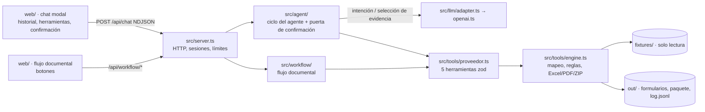

# Solución · Agente conversacional "Registro como Proveedor"

## 1. Problema en una frase

La analista administrativa transcribe a mano, en cada solicitud de registro como proveedor, datos que ya existen en el repositorio maestro y busca los soportes uno por uno. Eso causa retrabajo, errores en datos sensibles (NIT, cuenta bancaria), dependencia de una persona y días de espera que retrasan la facturación.

## 2. Arquitectura

| Responsabilidad | Dónde vive |
|---|---|
| **Comportamiento** (system prompt) | `agent/prompt.md`, leído en cada llamada al modelo. |
| **Conocimiento** del proceso | `src/knowledge/registro-proveedor.md`, enviado al modelo como `process_knowledge`. |
| **Ejecución** | `src/tools/proveedor.ts` (contrato público: `description`, `args` zod con `.describe()`, `execute(args, ctx)` que devuelve un JSON en texto y nunca lanza) y `src/tools/engine.ts` (reglas y archivos). |
| HTTP y sesiones | `src/server.ts`. No contiene reglas de negocio: un cambio de reglas no lo toca. |

Las herramientas no importan el servidor: `demo.ts` y `modulo/` las usan directamente. Las reglas por país, el glosario y las vigencias viven en el motor y en los fixtures, no en el servidor ni en el prompt.

## 3. Ciclo del agente

Cada mensaje del chat ejecuta un turno en `src/agent/orchestrator.ts`:

1. **Caso.** Si el mensaje menciona un caso (`ec-corp-andina`), el agente lo lee y cambia a él. Cambiar de caso descarta cualquier confirmación pendiente.
2. **Intención.** Con `LLM_API_KEY`, el modelo recibe el prompt, el conocimiento y los esquemas de las herramientas, y devuelve **solo** una intención de una lista cerrada (`leer`, `mapear`, `formulario`, `preparar`, `paquete`, `simular`, `resumen`, `ayuda`, `consulta`), validada con zod. Sin clave, o si el modelo falla, se usan palabras clave ordenadas («procesa… no envíes nada» es `preparar`, no `simular`).
3. **Herramientas.** Cada intención ejecuta una secuencia fija de herramientas. Por ejemplo, `preparar` llama a leer, mapear y generar. Cada llamada se emite al chat (`tool_call` con argumentos y `tool_result`) y queda en `out/log.jsonl` y `out/<caso>/log.jsonl` (CA4).
4. **Respuesta.** El resumen visible se construye con los datos que devolvieron las herramientas. En una `consulta`, el modelo solo puede elegir identificadores de evidencia entre los resultados de las herramientas; la app arma el texto con esas etiquetas, valores y fuentes. El modelo nunca escribe valores (CA2).
5. **Tope.** Cada llamada a herramienta o al modelo consume una iteración. Al llegar a `AGENT_MAX_ITERATIONS` (25), el turno se corta, se conserva lo obtenido y se informa (CA1). Errores de herramientas o del proveedor se muestran en lenguaje claro y la sesión sigue viva (CA5).

**Confirmación humana (CA3, RN4).** `src/agent/confirmation.ts` guarda una sola pregunta pendiente, ligada a la acción, el caso y el artefacto (formulario o paquete). El permiso solo se concede si el **siguiente** mensaje es afirmativo («sí», «confirmo»…), y se consume una vez. Un mensaje intermedio, una cita («mi jefe dijo "sí"») o un cambio de caso lo anulan. El motor de herramientas vuelve a verificar el permiso antes de armar el paquete o simular el envío, así que ni el modelo ni el navegador pueden saltárselo. El front resalta la pregunta pendiente con botones Sí / No.

Secuencia del envío: «procesa…» genera el formulario y pregunta por el paquete. «envía» (sin paquete) pide confirmar el paquete. El «sí» lo arma; si `listo_para_firma`, pregunta por el envío, y el segundo «sí» escribe solo `ENVIO-SIMULADO.md`. Si el paquete está bloqueado, el agente no propone el envío y dice qué soportes actualizar.

## 4. Elección del modelo

- **Proveedor y modelo:** OpenAI `gpt-4.1-mini`. Soporta salida JSON con esquema estricto, y la tarea del modelo (clasificar intención y elegir evidencia) no necesita redacción extensa.
- **Cambio de proveedor:** `LlmAdapter.enviar(mensajes, herramientas, opciones)` aísla el proveedor. Otro adaptador se inyecta al crear la sesión sin tocar el ciclo. Solo está implementado OpenAI.
- **Control de gasto:**
  - El runtime reserva un presupuesto conservador por llamada (bytes UTF-8 de la carga más la salida máxima), contra `LLM_MAX_SESSION_TOKENS` por sesión y `LLM_MAX_DAILY_TOKENS` por proceso y día UTC.
  - Se cuentan también las llamadas fallidas.
  - El timeout al proveedor (`LLM_TIMEOUT_MS`) se muestra como error claro.
  - `CHAT_RATE_LIMIT` limita los POST por IP.
- **Costo estimado por caso:** se estima, no se midió, porque no hubo clave disponible durante la construcción.
  - Fórmula: `(tokens_entrada × precio_entrada + tokens_salida × precio_salida) / 1.000.000`.
  - Un caso típico hace una clasificación por mensaje con frase libre, más una selección de evidencia por consulta.
  - Con 20.000 tokens de entrada y 1.500 de salida, y tarifas supuestas de USD 0,40 / USD 1,60 por millón, da **≈ USD 0,01 por caso**. Hay que verificar las tarifas vigentes antes de publicar.
  - Las órdenes reconocidas por palabras clave y el flujo documental no consumen tokens.

## 5. Diseño del portal web (§7.4)

**Hoy.** El caso de Panamá responde «Formato no soportado: portal web» y genera `out/pa-logistica-istmo/valores-portal.md` con etiqueta, valor, estado y fuente, listos para copiar. No inicia sesión ni dice haber cargado nada.

**Estrategia de automatización.** Navegador controlado por el agente (Playwright) en una sesión aislada por operador:
- Selectores por etiqueta y rol accesible.
- Pruebas por versión del portal.
- Pausa ante un layout desconocido.

El agente solo **rellenaría campos y adjuntaría soportes**, con una vista previa antes de cada cambio. Descarté RPA de escritorio por ser frágil y costosa de mantener. Una extensión de navegador queda como alternativa si el cliente bloquea navegadores automatizados.

**Límites.** CAPTCHA, MFA, cambios de estructura y términos del cliente que prohíban automatizar. Ante cualquiera de ellos, el agente se detiene y cede el control al humano, sin intentar eludirlos.

**Credenciales:**
- Nunca están en el repositorio, el prompt, el modelo ni los logs.
- Las ingresa el operador directamente en el navegador del portal, o se toman de un gestor corporativo de secretos fuera del alcance del modelo.
- Se desactivan grabaciones en las pantallas de autenticación y las cookies se destruyen al terminar.

**Reparto:**

| Agente | Humano |
|---|---|
| Prepara los valores, navega a los formularios, rellena campos y adjunta soportes. | Ingresa credenciales, resuelve MFA y CAPTCHA, revisa la vista previa y pulsa «Enviar». |

## 6. Decisiones y trade-offs

| Decisión | Alternativa descartada y por qué |
|---|---|
| El modelo elige una intención de una lista cerrada; las herramientas se ejecutan en secuencias fijas. | **Tool calling libre** (el modelo decide qué herramienta llamar y con qué argumentos). Es lo que describe el PRD y la opción más flexible, pero abre la puerta a argumentos inventados (un mapeo alterado, `confirmado: true` sin pregunta). Elegimos control y trazabilidad; el costo es menos flexibilidad ante peticiones compuestas. Es la siguiente evolución natural: el contrato de herramientas y la puerta de confirmación ya lo soportan. |
| Respuestas armadas con evidencia de herramientas. | **Prosa libre del modelo:** podría introducir nombres, cuentas o vigencias sin fuente. |
| Puerta de confirmación en el servidor, por acción, caso y artefacto. | **Confiar en el `confirmado` que manda el modelo o el navegador:** permitiría saltarse la confirmación. |
| Palabras clave cuando no hay clave LLM. | **Exigir clave para usar el chat:** la defensa y `demo.ts` no deberían depender de un proveedor externo. |
| Chat como ventana modal sobre un flujo documental por botones. | **Solo chat:** para la tarea repetitiva de la analista, los botones son más rápidos; el chat cubre la conversación y la demo del PRD. |
| Formularios reconstruidos desde los mapas JSON. | **Rellenar binarios originales:** no fueron entregados. El Excel respeta hoja y celda; el PDF respeta el orden. |
| `FECHA_EVALUACION` visible y nunca futura. | **Editar vigencias en los fixtures:** los fixtures no se modifican, y una fecha futura serviría para ocultar vencimientos. |
| HTML y JS sin framework en el front. | **SPA con build:** no aporta nada al reto y añade dependencias. |

## 7. Supuestos

- **Glosario:** las equivalencias se aplican por coincidencia exacta de etiqueta. Una etiqueta sin equivalencia o sin valor en el maestro es `faltante`; nunca se inventa.
- **Identificador tributario (RN1):**
  - En EC, PE, PA y HN el campo se llena con el NIT colombiano y queda `requiere_confirmacion` con confianza 0,7, la nota «identificador extranjero» y el equivalente del país (RUC o RTN).
  - Las etiquetas ambiguas («Identificación tributaria») también requieren confirmación.
  - Un mapeo explícito del glosario tiene confianza 1.
- **Soportes (RN3):**
  - Un soporte vencido, ausente del índice o sin archivo bloquea `listo_para_firma`. Un campo faltante no lo bloquea, pero aparece en el checklist.
  - Un paquete bloqueado no se propone para envío.
- **Fechas:** la vigencia se evalúa contra la fecha UTC de ejecución, o contra `FECHA_EVALUACION` si se define.
- **Datos bancarios (RN2):** solo se escriben donde la plantilla los pide y nunca en `borrador-correo.md`.
- **Repositorio maestro:** se admite tanto `fixtures/reto-01/repositorio/` (estructura del PRD) como la estructura entregada (`maestro.json` y `soportes/` en la raíz).
- **Plantillas y demo:**
  - Una plantilla corrupta, ausente o con un mapa inválido no detiene el caso: el mapeo devuelve el reporte de soportes y un aviso, y solo se bloquea el formulario.
  - `out/` es efímero: `demo.ts` lo limpia al iniciar.

## 8. Cobertura

| Historia / requisito | Estado | Evidencia · qué falta para producción |
|---|---|---|
| HU-1 Leer la solicitud | Hecho | Campos, país, cliente, formato, soportes y equivalentes por país. |
| HU-2 Mapear al maestro | Hecho | Tres estados con ruta en el maestro, glosario y confianza. Falta validación legal de equivalencias reales. |
| HU-3 Excel (P0) y PDF (P1) | Hecho | Hoja y celda del mapa; PDF ordenado. Faltan las plantillas binarias originales del cliente. |
| HU-3 Portal (P2) | Hecho (alcance P2) | «Formato no soportado» y `valores-portal.md`. Diseño en §5. |
| HU-4 Paquete para firma | Hecho | Formulario, soportes, checklist presentes / vencidos / ausentes, borrador de correo, resumen en el chat, pregunta explícita y `ENVIO-SIMULADO.md` tras confirmación. |
| HU-5 Manejo de errores | Hecho | `{ ok, data }` / `{ ok: false, error }`, nunca lanza. Una plantilla corrupta conserva el reporte de soportes. Caso inexistente y formato no soportado con mensaje claro. |
| Front de chat (§6.1) | Hecho | Modal con historial, «pensando», tarjetas de herramientas y confirmación resaltada. |
| Ciclo del agente con LLM (§6.1, CA1–CA5) | Parcial | Tope, confirmación, log y errores claros. El modelo elige intención y evidencia; no hace tool calling libre (ver §6). Falta probarlo con una clave real. |
| API (§6.4) | Hecho | `/api/chat`, `/api/sessions/:id`, `/api/health`. |
| `demo.ts` sin modelo | Hecho | Cuatro casos, cinco herramientas, sin clave. |
| Link público (§9.3) | Pendiente | Docker y Render listos. Falta crear el servicio con una cuenta de hosting. |
| Bonus `modulo/` | Hecho | Prompt, conocimiento y herramientas generados desde las mismas fuentes; `module:check` evita que diverjan. |

Para producción también falta: autenticación y cuotas por usuario, persistencia cifrada, contadores de gasto compartidos y plantillas reales del cliente.

## 9. Uso de IA

- **Codex.** Inspección de los fixtures, contratos zod, motor de herramientas, pruebas, primera versión del front y documentación.
- **Claude Code.** Revisión del cumplimiento contra el PRD y la estructura de §6.5, y además:
  - mover el servidor a `src/server.ts` y el front a `web/`;
  - recuperar el chat como modal;
  - hacer que el guion de §11 funcione sin clave (palabras clave y encadenado de paquete y envío);
  - `FECHA_EVALUACION`;
  - reporte parcial con plantilla corrupta y checklist en tres secciones;
  - pruebas unitarias, HTTP y E2E del guion;
  - este documento y el README.
- **Herramienta de imágenes.** Fondo reprocesado a partir de una referencia visual (`docs/DISENO.md`).

**Propuestas descartadas:**
- Dejar que el modelo redacte respuestas o devuelva valores: lo reemplazamos por selección de evidencia.
- Integrar correo real: es un no-objetivo del PRD.
- Desplazar la vigencia de los fixtures para la demo: se prefirió una fecha simulada, visible y validada.
- Tool calling libre sin poder probarlo con una clave: queda documentado como trade-off.

El historial de Git muestra cada cambio. `EXPLICACION_CODIGO.md` sirve para preparar la explicación línea a línea.

## 10. Riesgos de producción y mitigación

| Riesgo | Mitigación |
|---|---|
| El modelo «completa» un campo faltante. | Las herramientas son la única fuente de valores. El modelo solo elige intención o evidencia, y el prompt prohíbe valores fuera del mapeo. |
| Gasto descontrolado de la clave. | Topes por turno, sesión y día, límite por IP y tope de gasto en la cuenta del proveedor. Con varias réplicas, contadores centralizados. |
| Datos sensibles (cuentas, identificaciones). | Datos ficticios hoy. En producción: minimizar lo que va al proveedor, acuerdos de tratamiento, cifrado, retención y permisos por empresa. Los logs ya excluyen valores bancarios y claves. |
| Sesiones y archivos en memoria y disco local. | Se pierden al reiniciar (el plan gratuito duerme). Usar almacenamiento persistente y cifrado, y backups. |
| Plantillas reales peores que los fixtures. | Validación de formatos, límites de tamaño, pruebas con documentos representativos y el reporte parcial ya implementado. |
| Validez legal de equivalencias y vigencias. | Revisión humana obligatoria y un dueño del dato para el maestro y los soportes. |
| Portales con CAPTCHA o MFA. | El humano opera el portal; el agente prepara los valores (§5). |

## Dependencias justificadas

| Dependencia | Necesidad |
|---|---|
| zod | Argumentos, salidas, fixtures y contratos de herramientas (obligatorio por el PRD). |
| zod-to-json-schema | Derivar los esquemas que ve el modelo desde los mismos esquemas zod. |
| ExcelJS | Escribir el XLSX respetando hoja y celda. |
| pdf-lib | Generar el PDF con etiqueta y valor en orden. |
| fflate | ZIP del paquete. |
| dotenv | Leer `.env` en el backend. |
| TypeScript, tipos de Node, tsx | Tipado estricto y ejecución de fuentes. |
| Playwright | Pruebas E2E del chat y del flujo documental. |
| Bun (local) | Verificar el comando de demo del PRD sin instalarlo globalmente. |

`pnpm-workspace.yaml` fija `exceljs>uuid` en 11.1.1 para sustituir una versión transitiva vulnerable.
